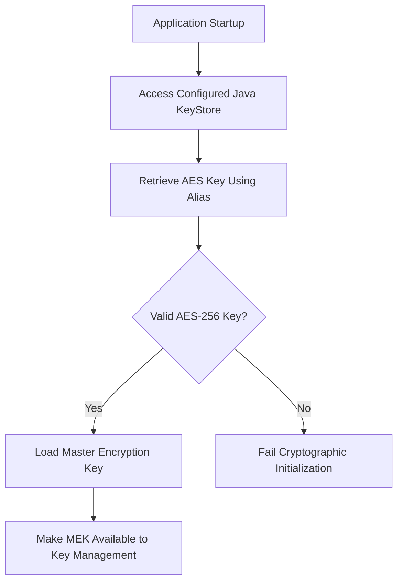
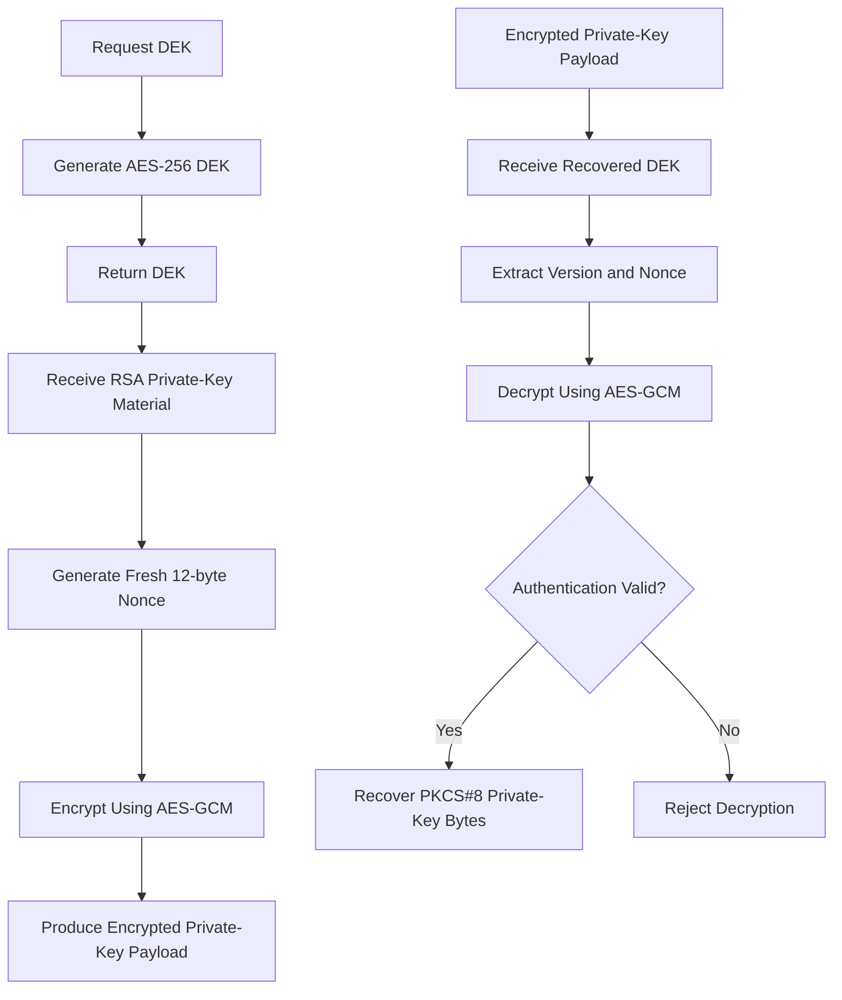
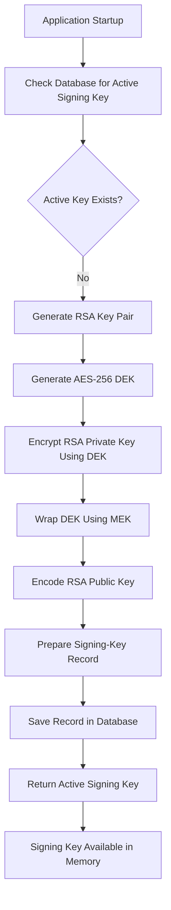
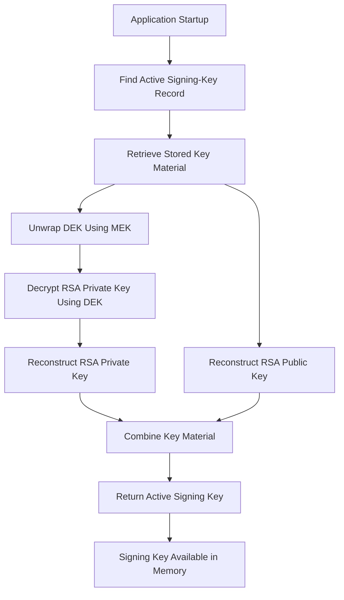
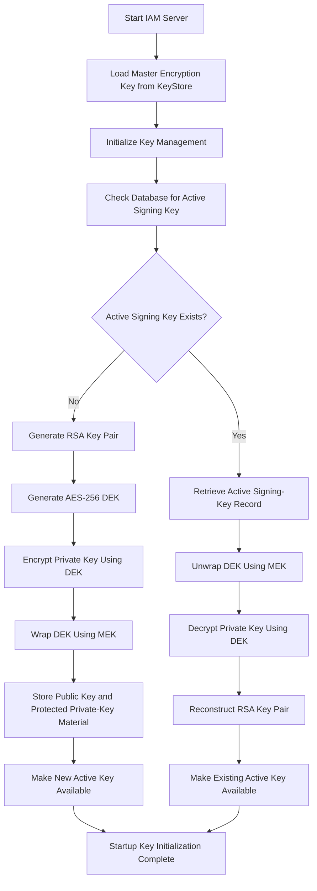

# IAM Server — Startup Cryptographic Key Management

## 1. Overview

The IAM Server requires cryptographic keys to sign and verify JWTs securely.

To make JWT signing available after application startup, the system initializes and loads its encryption and signing keys through three connected modules.

These modules are:

1. **Master Encryption Key Loading** — Loads the master AES encryption key from the configured Java KeyStore.
    
2. **DEK Generation and RSA Private-Key Encryption** — Generates Data Encryption Keys (DEKs) and provides encryption/decryption of RSA private-key material using AES-GCM.
    
3. **Active Signing Key Management** — Checks whether an active RSA signing key exists in the database. If one does not exist, it creates and stores one. Otherwise, it loads and reconstructs the existing active signing key.
    

### Overall responsibility

The objective is to ensure that:

- The master encryption key is loaded securely from the configured KeyStore.
    
- RSA private keys are never stored in the database as plaintext.
    
- Each generated RSA private key is encrypted using a DEK.
    
- Each DEK is protected using the master encryption key.
    
- The public key is stored separately and can be used for JWT verification.
    
- The active signing key is available in application memory after startup.
    

---

# 2. Module One — Master Encryption Key Loading

## Purpose

This module is responsible for loading the Master Encryption Key (MEK) from the configured Java KeyStore.

The MEK is the highest-level encryption key used by the application to protect the DEKs.

The application does not generate a new MEK every time it starts. Instead, it loads the already-provisioned key from the configured KeyStore using its alias and access credentials.

## How it works

1. The application starts its cryptographic initialization.
    
2. The configured KeyStore is accessed.
    
3. The application retrieves the AES key using its configured alias.
    
4. The key is checked to ensure that it is a valid AES key with the expected 256-bit size.
    
5. The loaded key is made available to the encryption-key management functionality.
    

The MEK remains separate from the signing key material stored in the database.

## Workflow diagram

```
````

``

## Important security responsibility

The MEK must be protected because anyone who obtains it, together with the stored wrapped DEKs, may be able to recover the DEKs and decrypt the corresponding RSA private keys.

The KeyStore and its access credentials must therefore be protected independently of the application database.

---

# 3. Module Two — DEK Generation and RSA Private-Key Encryption

## Purpose

This module provides the cryptographic operations required to protect RSA private-key material.

It has two closely related responsibilities:

1. Generate a Data Encryption Key (DEK).
    
2. Encrypt and decrypt RSA private-key material using AES-GCM.
    

The DEK is a temporary symmetric encryption key used to encrypt an RSA private key.

It is different from the MEK:

- MEK: Loaded from the Java KeyStore and used to protect DEKs.
    
- DEK: Generated when creating signing-key material and used to encrypt the RSA private key.
    

## A. DEK generation

When new signing-key material is required, the system generates a new AES-256 DEK.

The DEK is generated using Java's cryptographic key-generation facilities.

This key is subsequently used for AES-GCM encryption.

## B. RSA private-key encryption

After generating the RSA key pair, the system obtains the encoded private-key material.

The DEK is used to encrypt this private-key material using AES-GCM.

AES-GCM provides:

- Confidentiality: The private-key material cannot be read without the DEK.
    
- Integrity: Unauthorized modification of the encrypted data is detected.
    
- Authentication: The GCM authentication tag is checked during decryption.
    

A fresh 12-byte nonce is generated for each encryption operation.

The encrypted representation contains the format version, nonce, and ciphertext with its authentication tag.

## C. RSA private-key decryption

When the application needs to load an existing signing key:

1. The wrapped DEK is first recovered using the MEK.
    
2. The recovered DEK is passed to the private-key decryption functionality.
    
3. AES-GCM decrypts the encrypted RSA private-key material.
    
4. The resulting PKCS#8 encoded bytes are reconstructed into an RSA PrivateKey.
    

If the authentication tag does not validate, decryption must fail.

## Workflow diagram





## Important security responsibility

The DEK must not be stored in plaintext in the database.

The DEK is protected separately by the MEK before persistence.

The same AES-GCM DEK must be available to decrypt the private-key material that it originally encrypted.

A fresh nonce must be used for each encryption operation with a given DEK.

---


# 4. Module Three — Active Signing Key Management

## Purpose

This module coordinates the creation, storage, and loading of the IAM server's active RSA signing key.

It is the application-level orchestration responsible for ensuring that an active signing key is available after startup.

It uses the other two modules to perform the necessary cryptographic operations.

The module has two possible execution paths:

- First startup or missing active key: Generate and persist new signing-key material.
    
- Existing active key: Retrieve and reconstruct the previously stored signing key.
    

## A. First startup — Generate and save signing key

When the application starts, it checks the database for an active signing-key record.

If no active signing key exists, the system creates one.

### Workflow

1. Check the database for an active signing key.
    
2. If no active key exists, generate a new RSA key pair.
    
3. Generate a new AES-256 DEK.
    
4. Encrypt the RSA private key using the generated DEK and AES-GCM.
    
5. Protect (wrap) the DEK using the MEK.
    
6. Encode the RSA public key for storage.
    
7. Create the signing-key record with its identifier (`kid`), algorithm, public key, encrypted private key, wrapped DEK, status, and relevant timestamps.
    
8. Persist the record in the database.
    
9. Make the newly created active signing key available in application memory.
    

### First-startup workflow diagram





## B. Subsequent startup — Load existing active signing key

If an active signing-key record already exists in the database, the application does not need to generate a new RSA key pair.

Instead, it reconstructs the existing active signing key.

### Workflow

1. Retrieve the active signing-key record from the database.
    
2. Obtain the encrypted private-key material and wrapped DEK.
    
3. Use the MEK to unwrap the stored DEK.
    
4. Use the recovered DEK to decrypt the RSA private-key material.
    
5. Reconstruct the RSA private key from the decrypted PKCS#8 bytes.
    
6. Reconstruct the RSA public key from its stored encoded representation.
    
7. Combine the private key, public key, key identifier (`kid`), algorithm, and status into the active signing-key representation.
    
8. Make the reconstructed active signing key available in application memory.
    

### Subsequent-startup workflow diagram





## C. Complete startup decision flow

This diagram brings together the two execution paths.



---

# 5. How the three modules interact

The three modules are separate responsibilities, but they work together.

|Module|Main responsibility|Used by|
|---|---|---|
|Master Encryption Key Loading|Loads the MEK from the Java KeyStore|Key wrapping and unwrapping|
|DEK Generation and RSA Private-Key Encryption|Generates DEKs and encrypts/decrypts RSA private-key material|Signing-key creation and loading|
|Active Signing Key Management|Coordinates key creation, persistence, and loading|Application startup|

## Key protection hierarchy

The key hierarchy is:

```
Master Encryption Key (MEK)
    |
    | Protects / wraps
    v
Data Encryption Key (DEK)
    |
    | Encrypts / decrypts
    v
RSA Private Key
```

The RSA public key does not need to be encrypted for confidentiality. It can be stored in the database and exposed through the JWKS endpoint according to the IAM's public-key distribution policy.

## What is stored in the database?

|Stored value|Purpose|
|---|---|
|`kid`|Unique identifier for the signing key|
|Algorithm|Identifies the cryptographic algorithm|
|Public key|Used for JWT signature verification|
|Encrypted private key|Protected RSA private-key material|
|Wrapped DEK|DEK protected by the MEK|
|Status|Identifies whether the key is active or in another lifecycle state|
|Timestamps|Record creation and key lifecycle events|

The MEK itself is not stored in this signing-key database record.

---

# 6. Failure handling and security considerations

The startup process must fail safely if essential cryptographic operations cannot be completed.

Examples include:

- The configured KeyStore cannot be accessed.
    
- The MEK alias does not exist.
    
- The MEK is invalid or has an unexpected key size.
    
- RSA key generation fails.
    
- DEK generation fails.
    
- Private-key encryption or decryption fails.
    
- The wrapped DEK cannot be recovered.
    
- AES-GCM authentication fails.
    
- The database cannot retrieve or persist the signing-key record.
    

The system must not silently continue with an invalid or incomplete active signing key.

The creation workflow should also ensure that the database does not end up with multiple active signing keys because of concurrent startup attempts. This requires appropriate transaction handling and database-level protection.

---

# 7. Final summary

The startup key-management system follows a clear separation of responsibilities:

1. The **Master Encryption Key Loading module** provides the trusted master encryption key.
    
2. The **DEK and AES-GCM module** provides the symmetric encryption operations used to protect RSA private keys.
    
3. The **Active Signing Key Management module** decides whether to create a new signing key or reconstruct an existing one from the database.
    

Together, these modules ensure that the IAM server has an active RSA signing key available in memory after successful startup, while protecting private-key material at rest.